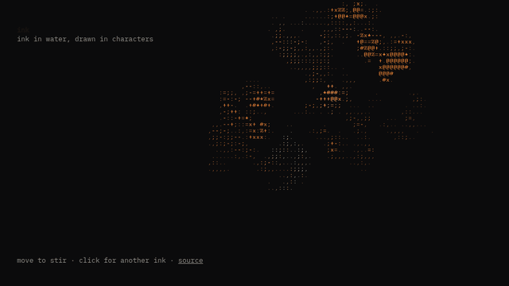
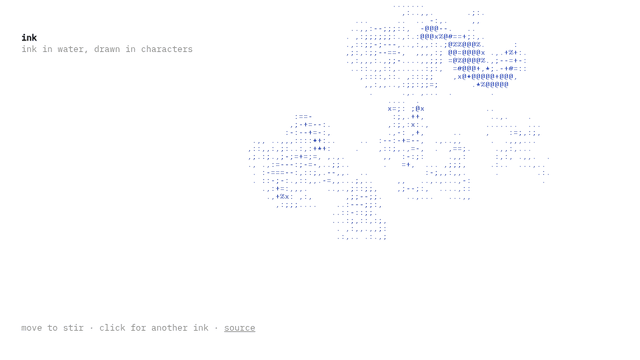

# ink

Ink in water, drawn in characters. A fluid simulation runs on the GPU, and every cell of ink is
drawn as a glyph, from ` . , :` where it's thin to `# % @` where it's dense. Move the cursor to
stir it; when nobody does, a slow unseen hand does.



It follows the system theme: amber light on black in dark mode, one blue ink on white in light
mode.



It runs as the homepage of [my portfolio](https://github.com/iliev-blnk). It has no
dependencies and is under 8 KB gzipped, including the fallback frames.

## How it works

- **Stable fluids** ([Stam 1999](https://www.dgp.toronto.edu/public_user/stam/reality/Research/pdf/ns.pdf)).
  - Each frame advects velocity and dye, adds vorticity confinement so curls survive, and solves
    pressure with 24 Jacobi iterations.
  - All of this runs in half-float WebGL2 framebuffers: 128 cells on the short side for velocity,
    512 for dye.
- **Light or absorbance.**
  - At night the dye is light, added to black.
  - On paper the dye stores how much light the ink absorbs, so overlapping strokes darken the
    way real ink does, instead of adding up to white.
- **Glyph pass.**
  - One fragment shader divides the screen into 7 × 12 px cells. Each cell averages its dye and
    maps it through a contrast curve onto the ramp ` .,:;-=+*x#%@`.
  - The glyph is read from a texture atlas drawn once in the page's font, and coloured by the
    ink's hue.
  - Cells under the page's text are masked, so the ink flows around the words.
  - An optional mode draws `- / | \` along the ink's contours from the dye gradient.
- **Staying light.**
  - The loop pauses in hidden tabs and when the canvas is offscreen.
  - A frame-time governor steps the simulation down (128 → 96 → 64 cells) on slow devices, and
    back up when there's room.
  - With `prefers-reduced-motion` it draws one still frame.
  - Without WebGL2 it shows a precomputed text frame (`scripts/still.mjs`).

## Use

```ts
import { mountInk } from "ink";

mountInk(document.querySelector("canvas")!, {
  // leave the page's text as paper
  mask: () => [...document.querySelectorAll("p")].map((el) => el.getBoundingClientRect()),
  // shown with a still frame when WebGL2 isn't available
  fallback: document.querySelector("pre.ink-fallback") as HTMLElement,
});
```

The options are:
- `look`: `"night"` or `"blue"`, to override the system theme.
- `seed`: makes the opening drops repeatable.
- `font`: the glyph font.

`mountInk` returns `{ destroy, refreshMask, mode }`, where `mode` is `"live"`, `"still"` or
`"fallback"`.

## Develop

```sh
pnpm install
pnpm dev                 # demo at localhost:5173
pnpm test                # unit tests
pnpm build:demo && pnpm smoke   # real-GPU smoke test (system Chromium)
node e2e/perf.mjs        # frame rate, desktop and a throttled phone
node scripts/gif.mjs night docs/ink.gif
```

## Licence

MIT
